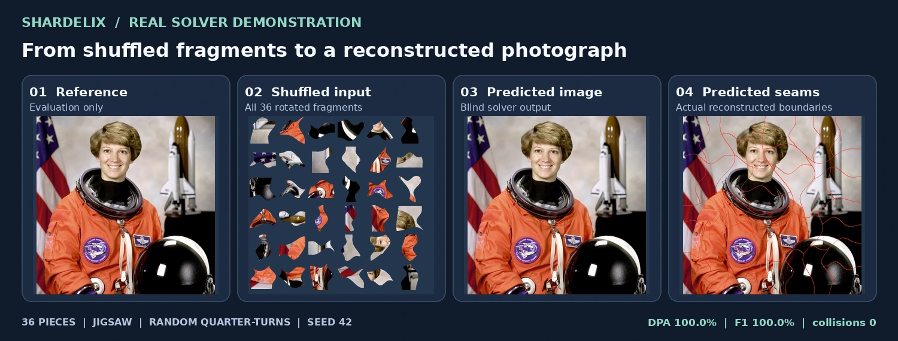
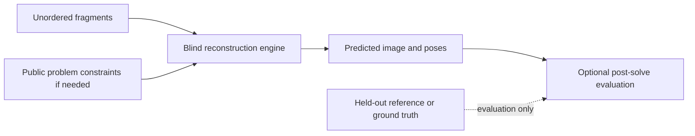
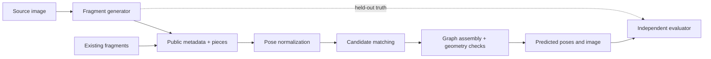

<div align="center">

# Shardelix

### Classical image & document reconstruction · blind by default

**Reconstruct the unseen. Recover structure from fragments alone.**

What if the original image no longer exists? No preview, no template, no answer key — just a collection of disconnected pieces.

Shardelix is a classical computer vision research framework for shuffled, rotated and potentially incomplete fragments. Blind reconstruction requires only the observed pieces; when the original image is available, explicit optional reference-assisted registration uses the same workflow.

**Blind mode: no reference image · No ground truth during inference · No pretrained model · No training dataset**

CPU-first Python and C++20 · Native execution and in-browser WebAssembly

> **One framework, one Studio:** Research algorithms are integrated into main.
> Automatic reconstruction is blind by default. Enable **Use original image for matching (optional)** only when you have the intact artwork.
> Ground truth remains a different, evaluation-only input. Choose Fast, Balanced
> (recommended), or High accuracy; the engine selects the appropriate solver.
> [Framework and routing](docs/FRAMEWORK.md) · [Optimization evidence](docs/OPTIMIZATION.md) · [DAFNE reference-assisted benchmark](docs/DAFNE_INDEXED.md) (28 official cases; not a blind benchmark).


[](pyproject.toml)
[](pyproject.toml)
[](#what-makes-shardelix-blind)
[](#how-it-works)
[](https://github.com/Daydreamer2812/Shardelix/actions/workflows/ci.yml)
[](https://github.com/Daydreamer2812/Shardelix/actions/workflows/web-smoke.yml)
[](cpp/)
[](docs/WEB.md)
[](https://github.com/Daydreamer2812/Shardelix/stargazers)
[](https://github.com/Daydreamer2812/Shardelix/releases)

[**Launch Web Studio**](https://daydreamer2812.github.io/Shardelix/) · [**Download V13**](https://github.com/Daydreamer2812/Shardelix/releases/latest) · [**Quick start**](#quick-start) · [**Capabilities**](#capabilities) · [**Benchmarks**](#benchmarks) · [**Python API**](#python-api) · [**Web deployment**](docs/WEB.md)

<!-- SHOWCASE_START -->


*Actual Shardelix output: 36 rotated jigsaw fragments, seed 42; DPA = 100.0%, adjacency F1 = 100.0%, collision pixels = 0. Reference photograph: NASA via scikit-image. [Measured results](reports/v13/photo-showcase.json) · [Reproduce](scripts/make_photo_showcase.py).*
<!-- SHOWCASE_END -->

</div>

---

## What makes Shardelix blind?

Most image restoration workflows start with some knowledge of the desired result. Shardelix tackles a different problem: **infer the arrangement of disconnected fragments when the target image is unavailable.** It searches for compatible boundaries and globally consistent relative poses using the evidence present in the pieces themselves.

| What the solver can use | What it does not receive |
|:--|:--|
| Fragment pixels, contours and alpha masks | Original or reference image |
| Color, texture and boundary continuity | Template or target thumbnail |
| Geometric compatibility and candidate relationships | Ground-truth positions, ordering or rotations |
| Public problem constraints, when needed (canvas dimensions, grid/cut family, expected count or angle mode) | Pretrained model weights or a training dataset |

The reconstruction and evaluation paths are deliberately separated. Ground truth is optional and is used **only after reconstruction** to measure performance; it is not required for solving imported fragments. Public geometric constraints are not ground truth about individual fragment poses.



If the available fragments do not uniquely determine the original arrangement, Shardelix can report ambiguity, unanchored groups or partial solutions rather than claim verified accuracy. Missing pixels are not hallucinated or inpainted.

## Why Shardelix?

Shardelix (formerly FragmentLab) brings **fragment generation, blind reconstruction, optional reference-assisted registration, geometric verification and reproducible benchmarking** into a single research framework.

- **Beyond rectangular puzzles:** supports grids, vertical and horizontal strips, jagged, wavy, jigsaw and mixed irregular digital cuts.
- **Unknown poses and incomplete inputs:** handles independent quarter-turns, experimental continuous in-plane rotations and missing fragments, subject to observable constraints.
- **Classical, explainable matching:** combines complementary boundary geometry, appearance continuity, sparse candidate graphs and consistency checks without neural training.
- **Scalable CPU-first implementation:** selected computational kernels are accelerated in C++20, with a Python reference backend and WebAssembly deployment.
- **One engine, multiple interfaces:** interactive Web Studio, local Studio, command-line tools and Python API.
- **Research-grade evidence:** separates blind inference from evaluation, exposes placements and diagnostics, and publishes reproducible measurements including failures.

## Get started in 60 seconds

| Try in your browser | Download a release | Integrate with Python |
|:--|:--|:--|
| [Open the live Studio](https://daydreamer2812.github.io/Shardelix/) — no install | [Latest release](https://github.com/Daydreamer2812/Shardelix/releases/latest) — source ZIP, prebuilt WebAssembly bundle, checksums | [Python API](#python-api) — use your own fragments |
| Choose a synthetic sample → Generate fragments → Send to reconstruction | Extract the source ZIP and follow the local quick start; the web ZIP needs a local HTTP server and internet on first run | Run blind matching, export image, poses and independent evaluation |

## Quick start

### 1. Run locally

Requires Python 3.11 or later.

```bash
git clone https://github.com/Daydreamer2812/Shardelix.git
cd Shardelix
python -m venv .venv
# Linux/macOS: source .venv/bin/activate
# Windows PowerShell: .venv\Scripts\Activate.ps1
python -m pip install -e .
python scripts/build_native.py   # optional C++20 compiler (g++ or clang++)
python -m shardelix studio
```

Open **Reconstruction**, import your fragment images or ZIP, leave **Automatic detection** and **Balanced**, and click Run. Uploading ground truth is optional and only for evaluation. To use the original for matching, explicitly enable the original-image option and select the matching image. The **Fragment generator** transfers independent evaluation truth, never enabling assisted matching.

The same workflow is available from one command:

```bash
python -m shardelix reconstruct fragments.zip --out outputs/blind
python -m shardelix reconstruct fragments.zip --reference original.jpg --out outputs/assisted
```

Python: `from shardelix import reconstruct_files`, then `reconstruct_files("fragments.zip", "outputs/blind")`. See [the unified framework](docs/FRAMEWORK.md).

### 2. Run directly in a browser (static build)

```bash
python scripts/build_web.py --out build/pages --wasm  # requires Emscripten SDK
python -m http.server 8767 --bind 127.0.0.1 --directory build/pages
```

Open **http://127.0.0.1:8767**. The browser uses the same C++20 kernels compiled to WASM, alongside the pinned Pyodide runtime and the Python reference algorithms, in a dedicated worker. A fallback static build without --wasm runs the Python reference. User fragments are not uploaded to a reconstruction server.

**[Open the hosted Web Studio](https://daydreamer2812.github.io/Shardelix/)** — no installation required. See [Web Studio & hosting](docs/WEB.md) for browser limits and self-hosting.

### 3. Run a reproducible experiment

```bash
python -m shardelix run data/examples/straight_texture.png \
  --cut grid --pieces 256 --rotations --profile balanced \
  --seed 42 --out outputs/grid
```

This creates anonymous shuffled PNG fragments, reconstructs them without the original image and evaluates the prediction separately. For existing fragments:

```bash
python -m shardelix solve --case path/to/case --out outputs/blind
```

The case directory contains public `case.json` geometry and a `pieces/` directory. No evaluation directory is needed to solve.

## How it works



The generator never calls the solver unless the optional benchmark mode is explicitly enabled. The reconstruction tab accepts existing pieces or direct handoff. Reference images and generated evaluation ZIPs are passed to an independent evaluator only after reconstruction.

The three performance profiles adjust search effort within the **same solver**, not separate applications:

| Profile | Intended use |
|:--|:--|
| **Fast** | Smaller search effort; one bounded rescue for severe irregular under-coverage |
| **Balanced** | Default adaptive route with bounded fallback and verification |
| **High accuracy** | Additional hypotheses and geometry checks; may take longer, not guaranteed to improve every case |

Batch benchmark repeats the same workflow with selected cut families, counts, rotations, seeds and profiles. Ground truth is reserved for independent evaluation.

## Capabilities

| Fragment setting | Supported |
|:--|:--|
| Rectangular grid | Yes |
| Vertical / horizontal strips | Yes |
| Jagged / wavy / jigsaw / mixed irregular | Yes |
| Independent quarter-turns | Yes |
| Arbitrary digital raster rotation | Experimental; alpha masks and observable constraints required |
| Missing fragments | Supported with holes, partial solutions and ambiguity diagnostics |
| Unknown-width digital document strips | Supported for same-height rectangular strips, including continuous angles |
| Real torn paper, perspective or arbitrary scale | Not generally supported |

| Resource guard | Native | Browser |
|:--|--:|--:|
| Uniform grid fragments | 262,144 | 4,096 |
| Strips / irregular fragments | 8,192 / 4,096 | 4,096 |
| Canvas pixels | 110 million | 8 million |
| Upload size (Studio) | 200 MiB | 32 MiB |
| Batch cases | 64 | 24 |

These are **protective resource ceilings**, not measured capacity or accuracy guarantees. Browser capacity depends on device memory and input geometry. PDF input is optional and native-only (`pip install -e ".[pdf]"`).

## Benchmarks

The V13 hybrid core accelerates exact mask contour tracing, edge descriptor extraction, sparse 2×2 cycle voting and seam re-ranking in C++20. The Python reference remains available (`SHARDELIX_CORE=python`); the same C ABI is used by the native shared library and WebAssembly. See [V13 changes and evidence](docs/V13_RESULTS.md) for actual parity tests and benchmark methodology.

| Uniform grid | Python reference | Native C++ hybrid | Solver speedup |
|:--|--:|--:|--:|
| 4,096 fragments (20 px cells) | 2.896 s | 1.308 s | **2.21×** |
| 16,384 fragments (20 px cells) | 11.203 s | 6.540 s | **1.71×** |

Both paired synthetic cases (seed 11226, quarter-turn) achieved 100% DPA and adjacency F1, with zero collisions. Native timings exclude generation, input import, rendering and evaluation; they are not browser or cross-solver speed claims. [Raw V13 measurements](reports/v13/paired.json).

Representative **historical measured V12 native CPU results**, not universal guarantees:

| Test | DPA | Adjacency F1 | Status |
|:--|--:|--:|:--:|
| Seven cut families · 256 pieces · quarter-turn | 100% | 100% | 7/7 pass |
| Grid · 16,384 · 20 px tiles | 100% | 100% | Pass |
| Grid · 65,536 · 12 px tiles | 99.85% | 99.86% | Pass |
| Grid · 16,384 · 8 px tiles | 0% | 10.50% | Fail |
| Jigsaw · 256 generated · 10% missing · continuous 1× | 91.30% | 92.26% | Fail |
| Multi-gap strips · paired holdout | — | — | V11: 0/8 → V12: 4/8 |

DPA = direct position accuracy; adjacency F1 measures correct neighboring relationships. Strict gates also account for collisions and recoverable coverage. The evaluator can account for the global rotation gauge but never freely shift the solution. Studio reports raw and rotation-aligned DPA separately; a reference-aligned preview is clearly labeled and never replaces the blind output. For per-case settings, timing, memory, the full failure rows and caveats, read [V12 results](docs/V12_RESULTS.md) and [raw numeric evidence](reports/v12/).

**Reproduce:**

```bash
python scripts/benchmark_profiles_v12.py --out outputs/profiles.csv
python scripts/benchmark_document12.py
python scripts/stress_v9.py --help
python -m pip install scikit-image==0.25.2
python scripts/make_photo_showcase.py
```

The historical V12 numerical evidence includes difficult and failed cases. It does not claim state-of-the-art performance against other published solvers without matched experimental protocols.

## Python API

```python
from shardelix import Solver

solver = Solver(profile="balanced")
result = solver.solve(
    "case/pieces",
    shape=(1024, 1024),
    cut="grid",
    grid=(32, 32),
    rotations=True,
)
result.save("outputs/blind")
print(result.summary())
```

The public result interface exposes the rendered image, cut overlay, affine poses, observable diagnostics and ambiguous or unanchored groups where applicable. DPA and F1 require independent ground truth and are not invented for blind imports.

See [Framework API](docs/FRAMEWORK_API.md) and [coordinates](docs/COORDINATE_CONVENTIONS.md).

## Repository structure

```text
Shardelix/
├── cpp/                 # Portable C++20 kernels
├── src/shardelix/     # Solver, geometry, CLI and Studio
├── web/                # Browser WebAssembly worker
├── data/examples/      # Generated, shareable synthetic fixtures
├── examples/           # Python integration
├── scripts/            # Build, verification and benchmark runners
├── tests/              # Algorithm and web regression tests
├── reports/             # Versioned numerical evidence
└── docs/               # API, evidence, datasets and web deployment
```

## Tests & development

```bash
python -m unittest discover -s tests/v2
python -m unittest discover -s tests/workflow
python scripts/smoke_studio.py
```

GitHub Actions checks supported Python versions and executes a real Chromium/WebAssembly smoke test (single reconstruction, batch, blind ZIP replay and responsive layout). New changes should preserve the blind-inference boundary and report failures alongside successes.

## Limitations & research roadmap

- Improve globally ambiguous, repeated or low-texture edges.
- Strengthen continuous-angle irregular reconstruction with missing fragments.
- Recover document order when text boundaries contain little usable evidence.
- Validate larger browser workloads and real-world acquisitions.
- Compare against published methods on the same datasets, metrics and hardware.

## Citation, contributions & usage

Shardelix is an alpha research project maintained by [Daydreamer2812](https://github.com/Daydreamer2812).
If using the framework in research, cite this repository and the exact commit or release version. [Citation metadata](CITATION.cff) enables GitHub's citation panel.

If Shardelix helps your research or coursework, consider starring the repository so you can find it again, or [report a reproducible case](https://github.com/Daydreamer2812/Shardelix/issues/new/choose). Honest success and failure reports are equally valuable.

- [Contributing](CONTRIBUTING.md)
- [Security](SECURITY.md)
- [Research references](docs/REFERENCES.md)
- [Dataset protocol](docs/DATASETS.md)

**License:** not yet assigned by the maintainer. Public repository visibility alone is not a license to redistribute or reuse the code. External datasets are not bundled; obtain them from their owners under the applicable terms.


### Experimental physical scans / photos

In the Web Studio **Reconstruction → Input type**, leave **Automatic detection**
for irregular scans or choose **Physical paper scans / photos** explicitly.
The scan pipeline segments separate paper pieces from a contrasting matte background
and estimates continuous rigid poses from complementary torn contours.
It supports multiple non-touching pieces on one sheet, folder-wrapped scan ZIPs,
and same-size binary foreground mask PNG sidecars (including scanned document strips).
A shared input classifier routes metadata-free rotated/nonuniform rectangular
tiles, unequal-width opaque or continuously rotated alpha strips, and foreground
scans or color-keyed artwork fragments to the appropriate solver. Up to 256
irregular pieces are supported with indexed contour/color retrieval for larger
sets. Disconnected groups remain explicitly unanchored.
For heavily damaged fragments, automatic gap-aware recovery evaluates inward
color/gradient continuation across eroded edges and exports independent component
poses without filling missing material. Explicit piece raster folders preserve
disconnected surviving mask islands. This is experimental and limited to 128
pieces in the gap-aware stage. A deeper classical continuation route adds
structure tensors, line-exit voting, masked Fourier translation search and
contextual pose consensus, with no ML or reference image. High accuracy
forces this bounded route; Balanced activates it on difficult inputs.
See [design and development results](docs/ERODED_RECOVERY.md).
Text-bearing strips use classical foreground rectification, relative orientation
from row projections, and multiscale ink-edge continuity, without character
recognition or language models. Ordering and global upright orientation are experimental.
It exports mask previews,
preprocessed PNGs, affine poses and an honest scan diagnostics report.
Test results (including two public physical scan sets) are in
[`reports/scan_simulation.json`](reports/scan_simulation.json) and
[`reports/scan_real.json`](reports/scan_real.json), and
[`reports/scan_strips.json`](reports/scan_strips.json) (pixel-only physical strip benchmark).
No ground truth is used in matching; full placement is not verified accuracy.
See [physical scan limitations](docs/WEB.md#physical-paper-scans-and-photos-experimental).
