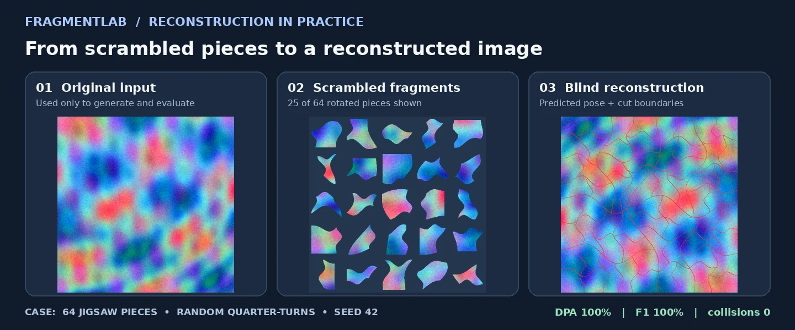
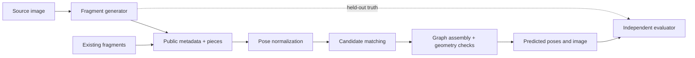

<div align="center">

# FragmentLab

### Classical CV for blind image fragment reconstruction

Reassemble shuffled, rotated and partially missing digital image fragments<br>
with one CPU-only reconstruction framework — no training data or neural models.

[](pyproject.toml)
[](pyproject.toml)
[](#how-it-works)
[](https://github.com/Daydreamer2812/fragmentlab-official/actions/workflows/ci.yml)
[](https://github.com/Daydreamer2812/fragmentlab-official/actions/workflows/web-smoke.yml)

[**Launch Web Studio**](https://daydreamer2812.github.io/fragmentlab-official/) · [**Quick start**](#quick-start) · [**Capabilities**](#capabilities) · [**Benchmarks**](#benchmarks) · [**Python API**](#python-api) · [**Web deployment**](docs/WEB.md)



*Actual V12 output: 64 synthetic jigsaw fragments, independent quarter-turns, seed 42. DPA = 100%, adjacency F1 = 100%, zero collision pixels. [Reproduce the example](scripts/make_showcase.py).*

</div>

---

## Why FragmentLab?

FragmentLab is a research framework for reconstructing digital images and documents from unordered fragments. It uses appearance continuity, complementary boundaries, rotation normalization, sparse graph assembly and geometric verification. The original image is **never** passed to the blind solver.

- **One framework, many cut families.** Rectangular grids, vertical and horizontal strips, jagged, wavy, jigsaw and mixed irregular fragments.
- **Flexible poses.** Upright, random quarter-turns and experimental continuous in-plane rotations; optional missing fragments with explicit uncertainty.
- **Two front ends.** Local Python Studio and static browser Studio using the same source code through Pyodide/WebAssembly.
- **Research-ready evaluation.** Generate reproducible synthetic cases, inspect blind placements, compare performance profiles and export benchmark reports.
- **CPU only.** NumPy, SciPy and Pillow; no model weights, API keys or GPU required.

## Quick start

### 1. Run locally

Requires Python 3.11 or later.

```bash
git clone https://github.com/Daydreamer2812/fragmentlab-official.git
cd fragmentlab-official
python -m venv .venv
# Linux/macOS: source .venv/bin/activate
# Windows PowerShell: .venv\Scripts\Activate.ps1
python -m pip install -e .
python scripts/build_native.py   # optional C++20 compiler (g++ or clang++)
python -m fragmentlab studio
```

Open the local Studio at **http://127.0.0.1:8765**. Choose **Fragment generator**, click *Use a synthetic sample*, set the cut and piece count, and generate. Use **Send to reconstruction** to transfer the anonymous pieces and a separately held reference. Or download the two ZIP files and re-import independently in **Reconstruction**.

### 2. Run directly in a browser (static build)

```bash
python scripts/build_web.py --out build/pages --wasm  # requires Emscripten SDK
python -m http.server 8767 --bind 127.0.0.1 --directory build/pages
```

Open **http://127.0.0.1:8767**. The browser uses the same C++20 kernels compiled to WASM, alongside the pinned Pyodide runtime and the Python reference algorithms, in a dedicated worker. A fallback static build without --wasm runs the Python reference. User fragments are not uploaded to a reconstruction server.

**[Open the hosted Web Studio](https://daydreamer2812.github.io/fragmentlab-official/)** — no installation required. See [Web Studio & hosting](docs/WEB.md) for browser limits and self-hosting.

### 3. Run a reproducible experiment

```bash
python -m fragmentlab run data/examples/straight_texture.png \
  --cut grid --pieces 256 --rotations --profile balanced \
  --seed 42 --out outputs/grid
```

This creates anonymous shuffled PNG fragments, reconstructs them without the original image and evaluates the prediction separately. For existing fragments:

```bash
python -m fragmentlab solve --case path/to/case --out outputs/blind
```

The case directory contains public `case.json` geometry and a `pieces/` directory. No evaluation directory is needed to solve.

## How it works



The generator never calls the solver unless the optional benchmark mode is explicitly enabled. The reconstruction tab accepts existing pieces or direct handoff. Reference images and generated evaluation ZIPs are passed to an independent evaluator only after reconstruction.

The three performance profiles adjust search effort within the **same solver**, not separate applications:

| Profile | Intended use |
|:--|:--|
| **Fast** | Smaller search effort; one bounded rescue for severe irregular under-coverage |
| **Balanced** | Default adaptive route with bounded fallback and verification |
| **High accuracy** | Additional hypotheses and geometry checks; may take longer, not guaranteed to improve every case |

Batch benchmark repeats the same workflow with selected cut families, counts, rotations, seeds and profiles. Ground truth is reserved for independent evaluation.

## Capabilities

| Fragment setting | Supported |
|:--|:--|
| Rectangular grid | Yes |
| Vertical / horizontal strips | Yes |
| Jagged / wavy / jigsaw / mixed irregular | Yes |
| Independent quarter-turns | Yes |
| Arbitrary digital raster rotation | Experimental; alpha masks and observable constraints required |
| Missing fragments | Supported with holes, partial solutions and ambiguity diagnostics |
| Unknown-width digital document strips | Supported for same-height rectangular strips, including continuous angles |
| Real torn paper, perspective or arbitrary scale | Not generally supported |

| Resource guard | Native | Browser |
|:--|--:|--:|
| Uniform grid fragments | 262,144 | 4,096 |
| Strips / irregular fragments | 8,192 / 4,096 | 4,096 |
| Canvas pixels | 110 million | 8 million |
| Upload size (Studio) | 200 MiB | 32 MiB |
| Batch cases | 64 | 24 |

These are **protective resource ceilings**, not measured capacity or accuracy guarantees. Browser capacity depends on device memory and input geometry. PDF input is optional and native-only (`pip install -e ".[pdf]"`).

## Benchmarks

The V13 hybrid core accelerates exact mask contour tracing, edge descriptor extraction, sparse 2×2 cycle voting and seam re-ranking in C++20. The Python reference remains available (`FRAGMENTLAB_CORE=python`); the same C ABI is used by the native shared library and WebAssembly. See [V13 changes and evidence](docs/V13_RESULTS.md) for actual parity tests and benchmark methodology.

Representative **historical measured V12 native CPU results**, not universal guarantees:

| Test | DPA | Adjacency F1 | Status |
|:--|--:|--:|:--:|
| Seven cut families · 256 pieces · quarter-turn | 100% | 100% | 7/7 pass |
| Grid · 16,384 · 20 px tiles | 100% | 100% | Pass |
| Grid · 65,536 · 12 px tiles | 99.85% | 99.86% | Pass |
| Grid · 16,384 · 8 px tiles | 0% | 10.50% | Fail |
| Jigsaw · 256 generated · 10% missing · continuous 1× | 91.30% | 92.26% | Fail |
| Multi-gap strips · paired holdout | — | — | V11: 0/8 → V12: 4/8 |

DPA = direct position accuracy; adjacency F1 measures correct neighboring relationships. Strict gates also account for collisions and recoverable coverage. The evaluator can account for the global rotation gauge but never freely shift the solution. For per-case settings, timing, memory, the full failure rows and caveats, read [V12 results](docs/V12_RESULTS.md) and [raw numeric evidence](reports/v12/).

**Reproduce:**

```bash
python scripts/benchmark_profiles_v12.py --out outputs/profiles.csv
python scripts/benchmark_document12.py
python scripts/stress_v9.py --help
python scripts/make_showcase.py
```

The historical V12 numerical evidence includes difficult and failed cases. It does not claim state-of-the-art performance against other published solvers without matched experimental protocols.

## Python API

```python
from fragmentlab import Solver

solver = Solver(profile="balanced")
result = solver.solve(
    "case/pieces",
    shape=(1024, 1024),
    cut="grid",
    grid=(32, 32),
    rotations=True,
)
result.save("outputs/blind")
print(result.summary())
```

The public result interface exposes the rendered image, cut overlay, affine poses, observable diagnostics and ambiguous or unanchored groups where applicable. DPA and F1 require independent ground truth and are not invented for blind imports.

See [Framework API](docs/FRAMEWORK_API.md) and [coordinates](docs/COORDINATE_CONVENTIONS.md).

## Repository structure

```text
fragmentlab-official/
├── cpp/                 # Portable C++20 kernels
├── src/fragmentlab/     # Solver, geometry, CLI and Studio
├── web/                # Browser WebAssembly worker
├── data/examples/      # Generated, shareable synthetic fixtures
├── examples/           # Python integration
├── scripts/            # Build, verification and benchmark runners
├── tests/              # Algorithm and web regression tests
├── reports/v12/        # V12 numerical evidence
└── docs/               # API, evidence, datasets and web deployment
```

## Tests & development

```bash
python -m unittest discover -s tests/v2
python -m unittest discover -s tests/workflow
python scripts/smoke_studio.py
```

GitHub Actions checks supported Python versions and executes a real Chromium/WebAssembly smoke test (single reconstruction, batch, blind ZIP replay and responsive layout). New changes should preserve the blind-inference boundary and report failures alongside successes.

## Limitations & research roadmap

- Improve globally ambiguous, repeated or low-texture edges.
- Strengthen continuous-angle irregular reconstruction with missing fragments.
- Recover document order when text boundaries contain little usable evidence.
- Validate larger browser workloads and real-world acquisitions.
- Compare against published methods on the same datasets, metrics and hardware.

## Citation, contributions & usage

FragmentLab is an alpha research project maintained by [Daydreamer2812](https://github.com/Daydreamer2812).
If using the framework in research, cite this repository and the exact commit or version.

- [Contributing](CONTRIBUTING.md)
- [Security](SECURITY.md)
- [Research references](docs/REFERENCES.md)
- [Dataset protocol](docs/DATASETS.md)

**License:** not yet assigned by the maintainer. Public repository visibility alone is not a license to redistribute or reuse the code. External datasets are not bundled; obtain them from their owners under the applicable terms.
