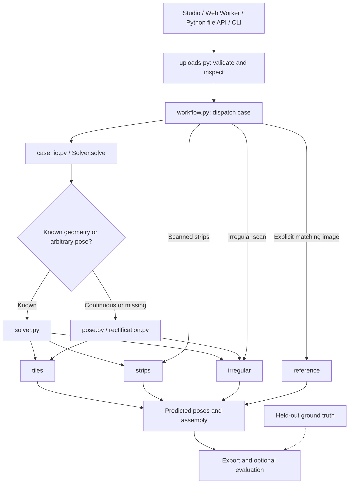

# Shardelix architecture (V14.0.1)

This maintenance update organizes the V14 algorithms by geometry rather than by
the version in which they entered the repository. It does not introduce a new
matching algorithm or change the blind/reference-assisted protocols.

## Entry points and data flow

| Location | Responsibility |
|---|---|
| `api.py` | Supported public `Solver`, `ReconstructionResult`, `reconstruct_files`. |
| `uploads.py` | Safe ZIP extraction, public metadata, mask handling, inspection and input budgets. |
| `workflow.py` | One file-level dispatcher: digital, physical scans/strips, explicitly assisted matching; generation and post-solve evaluation/export. |
| `reconstruction/case_io.py` | Solve/evaluate file cases; shared by CLI and workflow. |
| `reconstruction/solver.py` | Known-geometry routing; classic consensus, sparse shortlist and bounded irregular stages. |
| `reconstruction/pose.py` | Normalize arbitrary angles, dispatch to geometry-specific pose recovery, attach diagnostics. |
| `reconstruction/rectification.py` | Raster rotation and inversion; no matching or ground truth. |
| `reconstruction/quality.py` | Shared observed seam/coverage objective and canvas orientation; no dependency on the dispatcher. |
| `reconstruction/tiles/` | Grid edge profiles, candidate retrieval, reciprocal links, component packing, consensus, dense fallback and verification. |
| `reconstruction/strips/` | Pixel/ink continuity, unequal-width strips, scanned strips and single/multiple missing-gap recovery. |
| `reconstruction/irregular/` | Exact lattice arcs, verified contour assembly, tolerant raster recovery, physical scan segmentation and bounded eroded-edge continuation. |
| `reconstruction/reference/` | Optional original-image registration and independent comparison. |
| `native_core.py`, `cpp/core.cpp` | Shared optional C++20 kernels with Python fallback and WASM bridge. |

Shared data structures, resource policies, input inference, rendering,
generators and metrics remain at the reconstruction package root. Specialized
modules are internal implementation details, not additional user-facing solvers.

## Which route should I modify?

- **Regular tiles:** start with `tiles/sparse.py` and `tiles/consensus.py`.
- **Document strips:** start with `strips/ordering.py` or `strips/physical.py`.
- **Intact irregular pieces:** start with `irregular/lattice.py` or
  `irregular/verified.py`.
- **Eroded/damaged physical pieces:** start with `irregular/scan.py`;
  `continuation.py`, `eroded.py` and `spectral_gap.py` are recovery stages.
- **Original-image registration:** start with `reference/index.py`.
  Never enable this path implicitly.
- **Automatic input selection:** start with `workflow.py` and
  `reconstruction/input_detection.py`.

## Compatibility and migration

The supported top-level imports (`from shardelix import Solver, Fragment, Pose,
ResourceLimits, ReconstructionResult, reconstruct_files`), CLI commands, output
file names, Studio controls and diagnostic algorithm labels are unchanged.
The old `shardelix.workflow12` entry point forwards its commonly used public
functions to the new workflow/upload implementation. Existing CLI case helper
imports also remain available.

Low-level internal research imports have moved. Examples:

| Old module | New module |
|---|---|
| `pose9` | `pose` (dispatch), `rectification` (raster transforms) |
| `gridmetrics10`, `index10`, `links11` | `tiles.metrics`, `tiles.edge_index`, `tiles.links` |
| `sparse_grid`, `grid_consensus` | `tiles.sparse`, `tiles.consensus` |
| `anchor11`, `tolerant9` | `irregular.anchor`, `irregular.tolerant` |
| `document12`, `strip_gap11` | `strips.rectification`, `strips.single_gap` |
| `recovery12` | `irregular.frame_anchor`, `strips.multi_gap`, `tiles.verification` |
| `reference_index`, `reference_match` | `reference.index`, `reference.fft` |
| `scan`, `continuation`, `eroded` | `irregular.scan`, `irregular.continuation`, `irregular.eroded` |

Repository tests and benchmark runners use the new paths. Historical report
names and algorithm diagnostic values are retained for reproducibility.
See [V14 evidence](V14_RESULTS.md) for previous measured accuracy and scale limits;
do not interpret a refactor as a new DAFNE benchmark or SOTA result.

[Paired refactor parity evidence](../reports/v14/refactor_parity.json) compares eight deterministic fixtures against V14.0.0, including arbitrary rotations and missing pieces.
